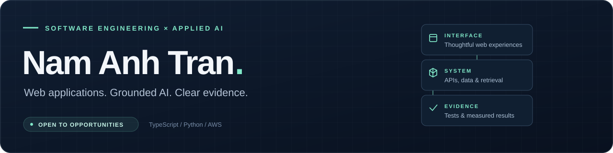

  

I build **full-stack web applications and AI systems** with TypeScript and Python, connecting useful interfaces to APIs, data pipelines, and retrieval systems.

**Exploring software engineering and AI/ML opportunities.** Start with the six projects below: each links to code, architecture, tests, or recorded experiment results.

### Tools I work with

**Languages** · TypeScript · Python · SQL · Java  
**Web** · Angular · React · Node.js · Express · PostgreSQL · MongoDB  
**AI & data** · RAG · AWS Bedrock · Ollama · PyTorch · Gymnasium · asynchronous ingestion  
**Delivery** · AWS Lambda · Cognito · Amazon S3 · Docker · GitHub Actions

## Selected work

<table>
<tr>
<td width="50%" valign="top">

01 / AI APPLICATIONS

<h3><a href="https://github.com/namanhtran200421/atlas-chatbot">Atlas Chatbot ↗</a></h3>

A knowledge assistant with access-aware retrieval, cited answers, and guest/member boundaries.

<strong>Look inside:</strong> source-aware chunking, fail-closed access checks, conversation handling, and retrieval evaluation.

PYTHON · ANGULAR · BEDROCK · LAMBDA · COGNITO

<a href="https://github.com/namanhtran200421/atlas-chatbot/tree/main/membership_atlas">Backend &amp; architecture</a> · <a href="https://github.com/namanhtran200421/atlas-chatbot/tree/main/membership_atlas/tests">Tests</a>

</td>
<td width="50%" valign="top">

02 / FULL-STACK ENGINEERING

<h3><a href="https://github.com/namanhtran200421/real_estate_web">VN Booking Hub ↗</a></h3>

An apartment booking application with a guest booking flow and an owner administration area.

<strong>Look inside:</strong> availability and holds, database integrity, reported transfers, and owner payment verification.

ANGULAR · TYPESCRIPT · EXPRESS · POSTGRESQL

<a href="https://github.com/namanhtran200421/real_estate_web/tree/main/docs/adr">Design decisions</a> · <a href="https://github.com/namanhtran200421/real_estate_web/tree/main/backend/security">Regression tests</a>

</td>
</tr>
<tr>
<td width="50%" valign="top">

03 / SIMULATION &amp; INTERACTIVE SYSTEMS

<h3><a href="https://github.com/namanhtran200421/hackathon">Melbourne Traffic Lab ↗</a></h3>

A team-built traffic simulation using Melbourne road and traffic-count data, running entirely in the browser.

<strong>Look inside:</strong> NetLogo in a Web Worker, live canvas rendering, road closures, and baseline comparisons.

REACT · TYPESCRIPT · NETLOGO · WEB WORKERS

<a href="https://github.com/namanhtran200421/hackathon/tree/main/simulation">Simulation</a> · <a href="https://github.com/namanhtran200421/hackathon/blob/main/docs/data-and-limitations.md">Data &amp; limitations</a>

</td>
<td width="50%" valign="top">

04 / LOCAL AI &amp; RETRIEVAL

<h3><a href="https://github.com/namanhtran200421/local_test_rag">Tan RAG Assistant ↗</a></h3>

A local-model assistant with separate public and internal knowledge indexes, server-owned state, and audit events.

<strong>Look inside:</strong> hybrid retrieval, role enforcement, citation validation, and live-model evaluation tooling.

OLLAMA · PYTHON · ANGULAR · EXPRESS · POSTGRESQL

<a href="https://github.com/namanhtran200421/local_test_rag/blob/main/documentation/architecture/production-rag.md">Architecture</a> · <a href="https://github.com/namanhtran200421/local_test_rag/blob/main/documentation/security/threat-model.md">Threat model</a>

</td>
</tr>
<tr>
<td width="50%" valign="top">

05 / DATA ENGINEERING

<h3><a href="https://github.com/namanhtran200421/fetching_script">WordPress Ingestion Pipeline ↗</a></h3>

An incremental pipeline for WordPress, HTML, and PDF sources, with local or S3 storage.

<strong>Look inside:</strong> immutable snapshots, bounded crawling, credential isolation, quality gates, and quarantine records.

PYTHON · ASYNC HTTP · ETL · AMAZON S3

<a href="https://github.com/namanhtran200421/fetching_script/blob/main/app/jobs/run_pipeline.py">Pipeline</a> · <a href="https://github.com/namanhtran200421/fetching_script/tree/main/tests">Offline tests</a>

</td>
<td width="50%" valign="top">

06 / MACHINE LEARNING &amp; EVALUATION

<h3><a href="https://github.com/namanhtran200421/DRL_VS_MPC_COMPARISON">Deep RL vs MPC ↗</a></h3>

Course-based vehicle-control experiments comparing learned and model-based controllers.

<strong>Look inside:</strong> reward shaping, controller tuning, profiling, and saved comparison data. The recorded comparison favours MPC.

PYTHON · PYTORCH · GYMNASIUM · STABLE-BASELINES3

<a href="https://github.com/namanhtran200421/DRL_VS_MPC_COMPARISON/tree/main/notebooks/notebook_outputs/final-rl-vs-mpc-comparison">Recorded results</a> · <a href="https://github.com/namanhtran200421/DRL_VS_MPC_COMPARISON#experiment-map">Experiment map</a>

</td>
</tr>
</table>

### More to explore

- **[Rosemarry Website](https://github.com/namanhtran200421/dating-app-website-new)** — prerendered Angular pages and an email-verified early-access workflow.
- **[Country Values Distance](https://github.com/namanhtran200421/testing_ground)** — multilingual semantic crawling and company-values extraction.

---

**How I work:** clear component boundaries, explicit access rules, and evidence reviewers can inspect. Project READMEs explain setup, team or course context, and current limitations.
